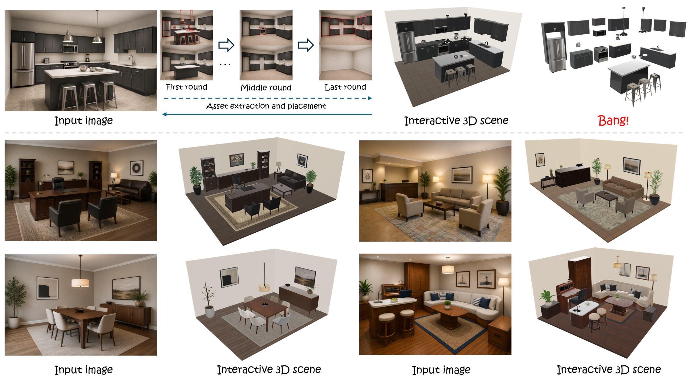
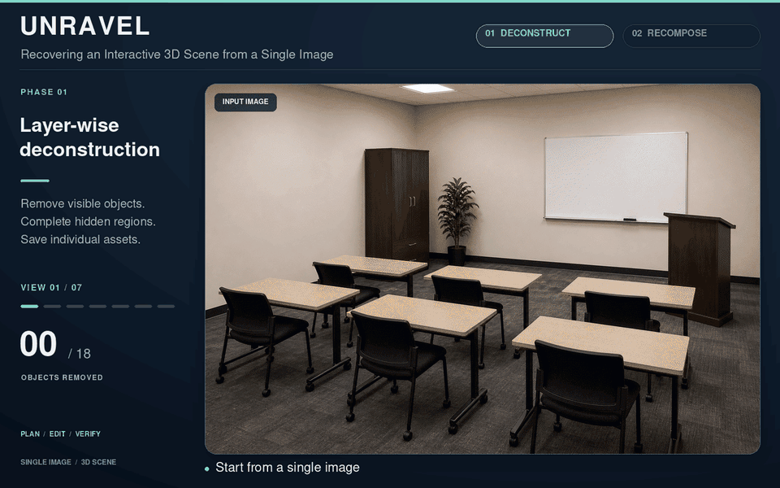
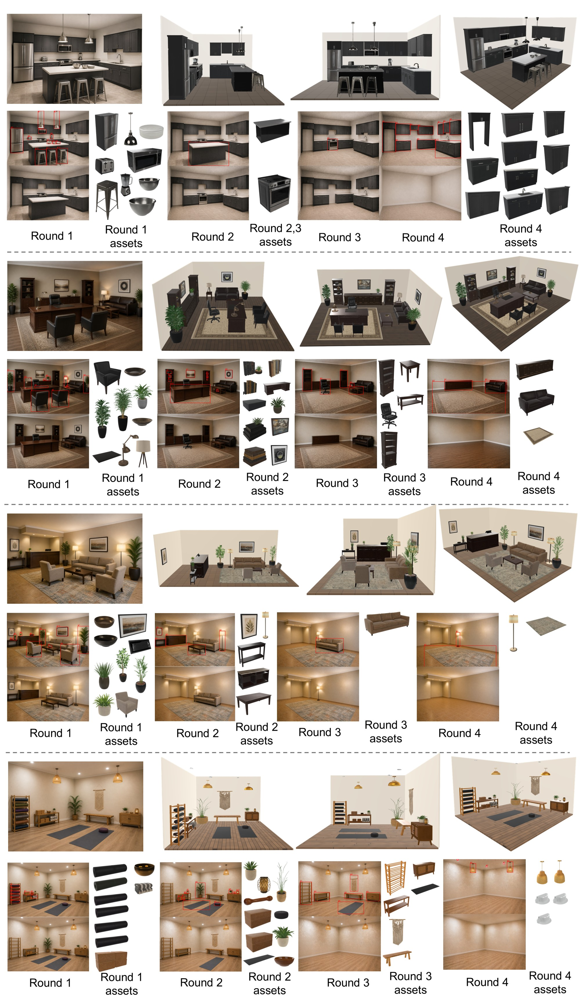
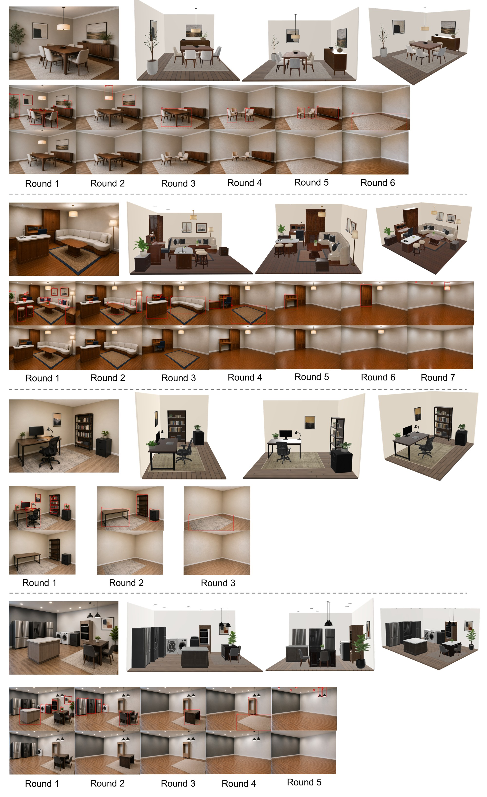
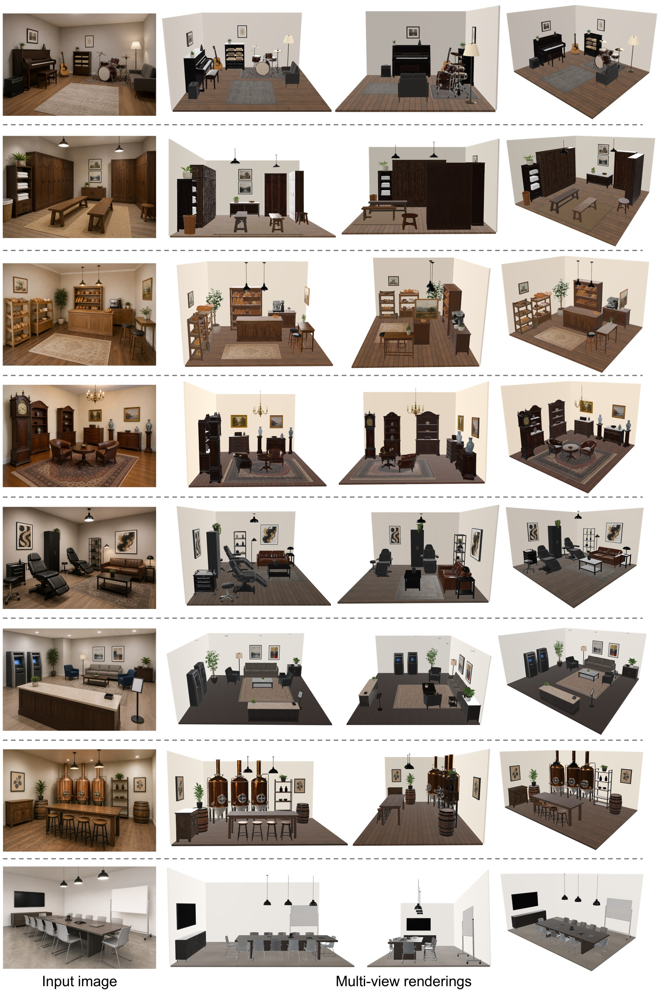

<div align="center">

# 🧶 Unravel: Recovering an Interactive 3D Scene from a Single Image


<a href="https://arxiv.org/abs/2610.16146"></a>
<a href="https://arxiv.org/abs/2610.02274"></a>
<a href="https://github.com/SII-Hui/Unravel"></a>

📢 Unravel is also covered in the technical report [*Awomo-SimDataEngine: Agentic Simulation-Ready World Generation*](https://arxiv.org/abs/2610.02274).

</div>

<p align="center">
  
</p>

✨ **Unravel** turns a single image into an interactive 3D scene where every object is an independent, movable asset. It first takes the scene apart, removing objects from the image layer by layer until the room is empty and capturing each one as a 3D asset when it is best exposed. It then rebuilds the scene in reverse removal order, followed by physical settling and an agentic audit, yielding a faithful and physically plausible layout.

## 🧩 Deconstruct → Recompose

<p align="center">
  
</p>

**Phase 1 · Layer-wise deconstruction**: plan, edit and verify removals round by round, saving each object as an individual asset before it is removed.  
**Phase 2 · Support-aware recomposition**: rebuild the scene in reverse order, aligning and placing each asset, refining support and reducing object overlap.

## 🚀 Quick Start

⚙️ Coming soon!

## 🎨 Qualitative Results

### 🔍 Layer-wise Deconstruction Traces

<p align="center">
  
</p>

<p align="center">
  
</p>


### 🏠 More Reconstructed Scenes

<p align="center">
  
</p>


## 🙏 Acknowledgements

Unravel is built upon several excellent open-source projects. We thank the authors of [MoGe](https://github.com/microsoft/MoGe), [SAM 3](https://github.com/facebookresearch/sam3) and [TRELLIS.2](https://github.com/microsoft/TRELLIS.2) for making their code and models publicly available.

## 📝 Citation

If you find this work useful, please consider citing:

```bibtex
@misc{shan2026unravelrecoveringinteractive3d,
      title={Unravel: Recovering an Interactive 3D Scene from a Single Image}, 
      author={Hui Shan and Keyang Luo and Binjia Zhou and Ming Li and Kai Li and Xin Wang and Zhenyang Li and Zesong Yang and Weikai Chen and Runze Zhang and Xin Wang and Yanwei Fu and Zhen Chen and Xiangru Huang},
      year={2026},
      eprint={2610.16146},
      archivePrefix={arXiv},
      primaryClass={cs.CV},
      url={https://arxiv.org/abs/2610.16146}, 
}
```
